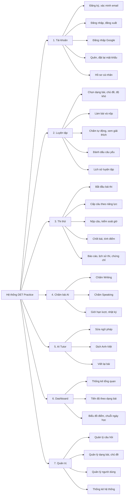
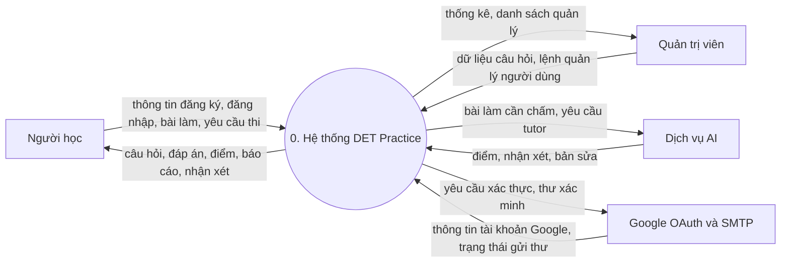
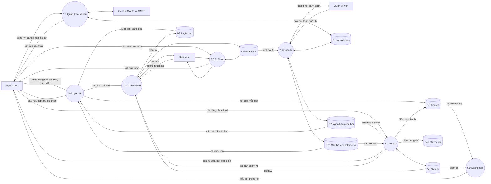
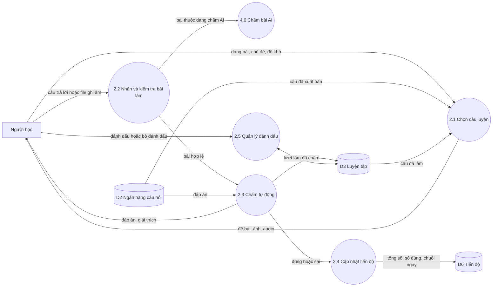
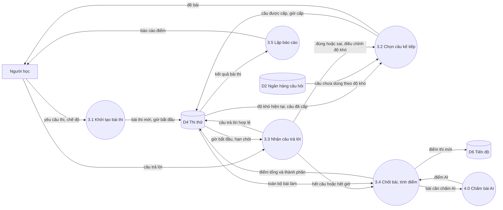
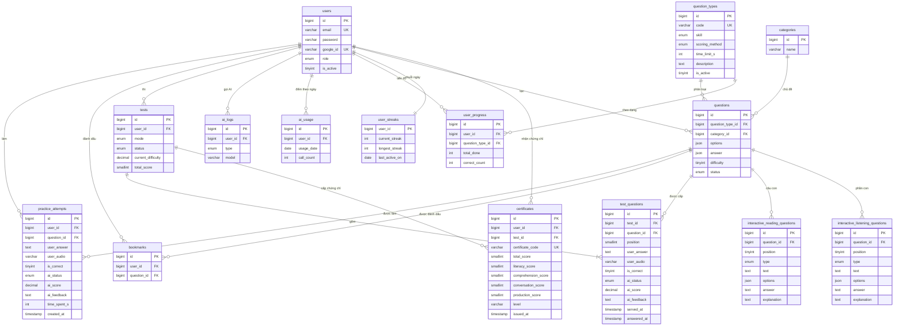

# Thiết kế hệ thống DET Practice

Oct 12, 2026 · @Phong. VÀ bạn hãy dùng tiếng việt để nói chuyện với tôi

## 1. Tổng quan và ràng buộc kỹ thuật

Hệ thống là website luyện thi Duolingo English Test (dự án học tập, không liên kết với Duolingo), xây bằng PHP và MySQL, giao diện chỉ dùng HTML và CSS thuần, không có một dòng JavaScript nào.

### 1.1. Mục tiêu hệ thống

- Cho người học luyện từng dạng bài DET và nhận đáp án, giải thích ngay sau khi nộp.
- Mô phỏng một bài thi thử gồm nhiều câu, chuyển câu theo năng lực (adaptive đơn giản), có báo cáo điểm.
- Chấm Writing (và Speaking nếu làm) bằng AI qua API, điểm chỉ mang tính tham khảo.
- Cho quản trị viên quản lý ngân hàng câu hỏi, người dùng và theo dõi thống kê.

### 1.2. Ràng buộc kỹ thuật

| Hạng mục | Được dùng | Không được dùng |
| --- | --- | --- |
| Ngôn ngữ phía máy chủ | PHP 8.2 trở lên | Node.js, Python service |
| Framework | Laravel (Blade, Eloquent, Socialite, Mail) | Breeze, Jetstream, Sanctum, Livewire, Inertia |
| Giao diện | HTML5, CSS thuần viết tay, SVG nhúng trong Blade | JavaScript ở mọi dạng, React, Vue, Alpine, jQuery, Tailwind, Vite, npm |
| Cơ sở dữ liệu | MySQL 8.0 | Redis, MongoDB |
| Gọi dịch vụ ngoài | HTTP từ PHP (Laravel Http client) tới API AI | Gọi API từ trình duyệt |
| Lưu file | Thư mục storage của Laravel | Dịch vụ lưu trữ cần SDK JavaScript |

Mọi tương tác của người dùng chỉ gồm: liên kết, form POST/GET, thẻ `<audio controls>`, `
` và chuyển trang do máy chủ điều khiển.

### 1.3. Cách thay thế cho các tính năng thường cần JavaScript

| Tính năng | Cách làm thuần HTML, CSS, PHP |
| --- | --- |
| Chuyển câu trong mock test | Mỗi câu là một trang form; POST xong máy chủ chọn câu kế và redirect |
| Giới hạn thời gian | Lưu `served_at` và hạn chót trên máy chủ, từ chối bài nộp quá hạn; trang hiển thị giờ hết hạn, dùng `<meta http-equiv="refresh">` để tự chuyển khi hết giờ |
| Ghi âm Speaking | `<input type="file" accept="audio/*">`, người học ghi âm bằng ứng dụng của máy rồi tải lên |
| Phát audio bài nghe | `<audio controls>`; không giới hạn được số lần nghe |
| Biểu đồ điểm | SVG hoặc thanh CSS dựng trong Blade từ dữ liệu PHP |
| Hiện/ẩn đáp án, mục thu gọn | Thẻ `
` hoặc CSS `:checked` |
| Chờ kết quả AI | Cột trạng thái `ai_status`; trang kết quả dùng meta refresh cho đến khi xong |
| Chat AI Tutor | Mỗi lượt là một form POST, lịch sử đọc lại từ bảng `ai_logs` |

## 2. Tác nhân và phân quyền

Hệ thống có ba tác nhân bên trong (Khách, Người học, Quản trị viên) và một hệ thống bên ngoài (dịch vụ AI), cùng các dịch vụ hỗ trợ như Google OAuth và SMTP.

| Tác nhân | Mô tả | Vai trò trong CSDL |
| --- | --- | --- |
| Khách | Người chưa đăng nhập, chỉ xem trang giới thiệu, đăng ký, đăng nhập | Không có bản ghi |
| Người học | Người dùng đã đăng nhập, luyện tập, thi thử, dùng AI | `users.role = 'user'` |
| Quản trị viên | Quản lý nội dung và người dùng | `users.role = 'admin'` |
| Dịch vụ AI | API ngoài nhận bài làm và trả điểm, nhận xét | Hệ thống ngoài |
| Google OAuth, SMTP | Đăng nhập Google, gửi email xác minh và đặt lại mật khẩu | Hệ thống ngoài |

### Ma trận phân quyền

| Chức năng | Khách | Người học | Quản trị viên |
| --- | --- | --- | --- |
| Xem trang chủ, đăng ký, đăng nhập | Có | Có | Có |
| Cập nhật hồ sơ, đổi mật khẩu | Không | Có | Có |
| Luyện tập theo dạng bài, chủ đề | Không | Có | Có |
| Đánh dấu câu hỏi | Không | Có | Có |
| Thi thử và xem lịch sử thi | Không | Có | Có |
| Dùng AI chấm bài, AI Tutor (có hạn mức) | Không | Có | Có |
| Xem dashboard cá nhân | Không | Có | Có |
| CRUD câu hỏi, dạng bài, chủ đề | Không | Không | Có |
| Duyệt câu hỏi (draft, review, published) | Không | Không | Có |
| Khóa/mở tài khoản, đổi vai trò | Không | Không | Có |
| Xem thống kê hệ thống | Không | Không | Có |

Quy tắc kiểm soát: middleware `auth` chặn người chưa đăng nhập, middleware `admin` chặn mọi route `/admin/*` với người không có `role = 'admin'`, và tài khoản có `is_active = 0` bị đăng xuất khi gửi yêu cầu kế tiếp.

## 3. Yêu cầu chức năng theo phân hệ

Hệ thống gồm 7 phân hệ. Cột Mức: BB là bắt buộc (MVP), MR là mở rộng làm nếu đủ điều kiện.

### 3.1. Phân hệ Tài khoản (TK)

| Mã | Chức năng | Mô tả | Mức |
| --- | --- | --- | --- |
| TK01 | Đăng ký bằng email | Nhập họ tên, email, mật khẩu; kiểm tra email chưa tồn tại; mật khẩu băm bằng bcrypt | BB |
| TK02 | Xác minh email | Gửi liên kết có chữ ký qua SMTP; chưa xác minh thì không vào khu vực người học | BB |
| TK03 | Đăng nhập | Email và mật khẩu, session; từ chối nếu `is_active = 0` | BB |
| TK04 | Đăng nhập Google | Laravel Socialite; gặp email đã có thì liên kết `google_id` vào tài khoản cũ | BB |
| TK05 | Đăng xuất | Hủy session, tạo lại token CSRF | BB |
| TK06 | Quên và đặt lại mật khẩu | Gửi liên kết đặt lại có thời hạn; tài khoản chỉ Google phải được đặt mật khẩu trước khi dùng email | BB |
| TK07 | Hồ sơ cá nhân | Sửa tên, ảnh đại diện, điểm mục tiêu DET (10-160), đổi mật khẩu | BB |
| TK08 | Phân quyền | Middleware `auth`, `verified`, `admin` | BB |

### 3.2. Phân hệ Luyện tập (LT)

| Mã | Chức năng | Mô tả | Mức |
| --- | --- | --- | --- |
| LT01 | Danh sách dạng bài | Hiển thị các dạng bài đang bật, nhóm theo kỹ năng (đọc, viết, nghe, nói) | BB |
| LT02 | Chọn câu luyện | Lọc theo dạng bài, chủ đề, độ khó 1-10; chỉ lấy câu `status = 'published'`; ưu tiên câu chưa làm | BB |
| LT03 | Làm bài | Mỗi câu một trang; hiển thị đề, ảnh, audio; không lộ đáp án trong HTML | BB |
| LT04 | Nộp và chấm tự động | Dạng `scoring_method = 'auto'` được so đáp án phía máy chủ, lưu vào `practice_attempts` | BB |
| LT05 | Xem đáp án, giải thích | Hiện sau khi nộp | BB |
| LT06 | Gửi bài chấm AI | Dạng `ai` chuyển sang phân hệ Chấm AI, kết quả lưu vào cùng lượt làm | BB |
| LT07 | Đánh dấu câu yếu | Thêm/bỏ đánh dấu; trang danh sách câu đã đánh dấu để ôn lại | BB |
| LT08 | Lịch sử luyện tập | Danh sách lượt làm, lọc theo dạng bài, ngày | BB |
| LT09 | Tìm kiếm câu hỏi | Theo từ khóa trong nội dung | MR |

### 3.3. Phân hệ Thi thử (MT)

| Mã | Chức năng | Mô tả | Mức |
| --- | --- | --- | --- |
| MT01 | Bắt đầu bài thi | Chọn chế độ `full` hoặc `section`; tạo bản ghi `tests` với `time_limit_s` và `started_at`; mỗi người chỉ có một bài đang `in_progress` | BB |
| MT02 | Cấp câu hỏi tiếp theo | Máy chủ chọn câu theo luật adaptive (mục 9), ghi `test_questions.served_at`, không lặp câu | BB |
| MT03 | Nộp từng câu | POST câu trả lời, từ chối nếu quá hạn hoặc câu đã có `answered_at`; redirect sang câu kế (POST-redirect-GET) | BB |
| MT04 | Kiểm soát thời gian | Tính thời gian còn lại từ `started_at`; hết giờ thì chốt bài | BB |
| MT05 | Kết thúc bài thi | Chấm các câu auto, gọi AI cho câu cần chấm, tính điểm 10-160 và bốn điểm thành phần | BB |
| MT06 | Báo cáo kết quả | Điểm tổng, điểm thành phần, số câu đúng theo dạng bài, đáp án và nhận xét từng câu | BB |
| MT07 | Lịch sử thi | Danh sách các lần thi, so sánh điểm | BB |
| MT08 | Bỏ dở bài thi | Chuyển `status = 'abandoned'` khi người học hủy hoặc bắt đầu bài mới | BB |
| MT09 | Cấp chứng chỉ thi thử | Lưu vào `certificates` (mã chứng chỉ, điểm tổng, 4 điểm thành phần, cấp độ) | BB |

### 3.4. Phân hệ Chấm bài AI (AI)

| Mã | Chức năng | Mô tả | Mức |
| --- | --- | --- | --- |
| AI01 | Chấm Writing | Gửi văn bản và đề bài tới API, nhận điểm theo tiêu chí và gợi ý sửa | BB |
| AI02 | Chấm Speaking | Tải file audio, chuyển thành văn bản (speech-to-text), rồi chấm nội dung và độ trôi chảy bằng mô hình ngôn ngữ | MR |
| AI03 | Giới hạn lượt gọi | Đếm theo ngày trong `ai_usage`, vượt hạn mức thì từ chối và báo rõ | BB |
| AI04 | Ghi nhật ký | Lưu đầu vào, đầu ra, tên mô hình, số token vào `ai_logs` | BB |
| AI05 | Trạng thái chấm | `ai_status` gồm pending, done, failed; lỗi API thì cho phép chấm lại | BB |
| AI06 | Bảo vệ khỏi chèn lệnh | Bài làm đặt trong khối dữ liệu riêng của prompt, không được xử lý như chỉ dẫn | BB |

Điểm AI chỉ mang tính tham khảo, đặc biệt với phát âm.

### 3.5. Phân hệ AI Tutor (TU)

| Mã | Chức năng | Mô tả | Mức |
| --- | --- | --- | --- |
| TU01 | Sửa ngữ pháp | Nhập đoạn văn, nhận bản sửa và giải thích lỗi | MR |
| TU02 | Dịch Anh-Việt | Dịch hai chiều | MR |
| TU03 | Viết lại bài | Gợi ý bản viết tốt hơn | MR |
| TU04 | Lịch sử hội thoại | Đọc lại từ `ai_logs`, mỗi lượt dùng chung hạn mức AI03 | MR |

### 3.6. Phân hệ Dashboard (DB)

| Mã | Chức năng | Mô tả | Mức |
| --- | --- | --- | --- |
| DB01 | Tổng quan học tập | Số câu đã làm, tỷ lệ đúng, thời gian luyện | BB |
| DB02 | Tiến độ theo dạng bài | Từ `user_progress`, hiển thị bằng thanh CSS | BB |
| DB03 | Biểu đồ điểm thi thử | Đường SVG vẽ trong Blade từ `tests.total_score` | BB |
| DB04 | Chuỗi ngày học | Từ `user_streaks` | BB |
| DB05 | Gợi ý bài hôm nay | Chọn dạng bài có tỷ lệ đúng thấp nhất | MR |

### 3.7. Phân hệ Quản trị (AD)

| Mã | Chức năng | Mô tả | Mức |
| --- | --- | --- | --- |
| AD01 | Quản lý câu hỏi | Thêm, sửa, lưu nháp, đưa vào review, xuất bản, lưu trữ (không xóa cứng câu đã dùng); tải ảnh, audio | BB |
| AD02 | Quản lý dạng bài | Bật/tắt, đặt `scoring_method`, giới hạn thời gian mặc định | BB |
| AD03 | Quản lý chủ đề | CRUD | BB |
| AD04 | Quản lý người dùng | Tìm, khóa/mở, đổi vai trò | BB |
| AD05 | Thống kê hệ thống | Số người dùng, câu hỏi theo dạng bài, lượt thi, lượt gọi AI theo ngày | BB |
| AD06 | Xem nhật ký AI | Lọc theo người dùng, loại, lỗi | MR |

### 3.8. Các dạng bài DET được hỗ trợ

Danh sách dưới đây trùng với dữ liệu mẫu trong mục 8 và cần đối chiếu với tài liệu Official Guide mới nhất của Duolingo trước khi chốt.

| Kỹ năng | Dạng bài | Cách chấm |
| --- | --- | --- |
| Đọc | Read and Select, Fill in the Blanks, Read and Complete, Interactive Reading | Tự động |
| Nghe | Listen and Type | Tự động |
| Nghe | Interactive Listening | AI |
| Viết | Write About the Photo, Interactive Writing, Writing Sample | AI |
| Nói | Read Aloud, Speak About the Photo, Read Then Speak, Listen Then Speak, Speaking Sample | AI |

Ghi chú: Read and Complete cần ô nhập từng chữ cái, không có JavaScript thì không tự nhảy ô; thay bằng một ô nhập cho mỗi từ khuyết.

**Interactive Reading** có 5 dạng câu hỏi con: Complete the Sentence, Complete the Passage, Highlight the Answer, Identify the Idea, Title the Passage.

**Interactive Listening** có 3 phần: Listen and Complete, Listen and Respond, Summarise the Conversation.

## 4. Yêu cầu hệ thống và phi chức năng

### 4.1. Môi trường chạy

| Thành phần | Yêu cầu |
| --- | --- |
| PHP | 8.2 trở lên, bật `pdo_mysql`, `mbstring`, `fileinfo`, `curl`, `openssl` |
| Laravel | Bản đang được hỗ trợ tại thời điểm triển khai (kiểm tra tại laravel.com/docs/releases) |
| MySQL | 8.0, bộ ký tự `utf8mb4`, engine InnoDB |
| Máy chủ web | Apache hoặc Nginx; XAMPP cho môi trường phát triển |
| Cấu hình PHP | `upload_max_filesize` và `post_max_size` đủ cho file audio; `max_execution_time` đủ cho một lần gọi AI |
| HTTPS | Bắt buộc ở môi trường thật (đăng nhập Google, bảo vệ session) |
| Thư mục lưu file | `storage/app/private` cho bài ghi âm; `public` chỉ chứa CSS, ảnh và audio đề thi |
| Biến môi trường | Khóa API AI, thông tin Google OAuth, cấu hình SMTP đặt trong `.env`, không đưa vào Git |

### 4.2. Yêu cầu phi chức năng

| Mã | Nhóm | Yêu cầu |
| --- | --- | --- |
| NF01 | Không dùng JavaScript | Không có thẻ `<script>`, không có thuộc tính sự kiện (`onclick`...), không có thư viện front-end; có thể kiểm tra bằng tìm kiếm trong thư mục `resources/views` |
| NF02 | Bảo mật dữ liệu | Mật khẩu băm bcrypt; truy vấn qua Eloquent hoặc tham số ràng buộc; Blade escape `{{ }}`, không dùng `{!! !!}` cho nội dung người dùng |
| NF03 | CSRF | Mọi form POST có `@csrf` |
| NF04 | Không lộ đáp án | Đáp án và giải thích chỉ gửi về trình duyệt sau khi nộp |
| NF05 | Tải file | Kiểm tra MIME thật, phần mở rộng, dung lượng tối đa; đặt tên ngẫu nhiên; file ghi âm phục vụ qua controller có kiểm tra quyền |
| NF06 | Giới hạn tần suất | Throttle cho đăng nhập, đăng ký, gọi AI |
| NF07 | Chống nộp lặp | Mỗi câu thi chỉ nhận một lần trả lời; nút quay lại không làm mất hoặc nhân đôi kết quả |
| NF08 | Toàn vẹn dữ liệu | Khóa ngoại, ràng buộc UNIQUE, CHECK; thao tác chốt bài thi nằm trong một giao dịch |
| NF09 | Quyền riêng tư | Có trang chính sách nêu rõ audio và văn bản được gửi tới bên thứ ba; nêu thời gian lưu và cách xóa; người dùng được xóa bài ghi âm của mình |
| NF10 | Độ tin cậy của AI | Điểm AI ghi chú là tham khảo; lỗi API không làm mất bài làm, chỉ đặt `ai_status = 'failed'` |
| NF11 | Tương thích | Chrome, Firefox, Safari, Edge bản mới; bố cục responsive bằng CSS (flex, grid, media query) |
| NF12 | Khả năng truy cập | Dùng thẻ ngữ nghĩa, nhãn cho mọi ô nhập, tương phản đủ đọc |
| NF13 | Bảo trì | Tách Controller, Service (`TestService`, `ScoringService`, `AIService`), Model; migration là nguồn duy nhất của lược đồ |
| NF14 | Kiểm thử | Có test cho luật chọn câu adaptive, tính điểm, hết giờ, phân quyền |
| NF15 | Ngôn ngữ giao diện | Tiếng Việt, thuật ngữ DET giữ tiếng Anh |

### 4.3. Hạn chế đã chấp nhận do không dùng JavaScript

- Không ghi âm trực tiếp trong trang; người học tải file lên.
- Không có đồng hồ đếm ngược chạy thời gian thực; hạn giờ do máy chủ kiểm soát.
- Không giới hạn được số lần nghe audio.
- Không gợi ý hay kiểm tra khi đang gõ; mọi kiểm tra diễn ra sau khi gửi form.
- Mỗi thao tác (chuyển câu, gửi lượt chat) tải lại trang.

## 5. Sơ đồ phân rã chức năng (BFD)

Hệ thống chia thành 7 phân hệ, mỗi phân hệ phân rã thêm một mức chức năng; mã chức năng khớp với mục 3.

Bảng đối chiếu mã chức năng với nhánh trong sơ đồ:

| Phân hệ | Nhánh BFD | Mã chức năng ở mục 3 |
| --- | --- | --- |
| Tài khoản | TK1-TK5 | TK01-TK08 |
| Luyện tập | LT1-LT5 | LT01-LT09 |
| Thi thử | MT1-MT5 | MT01-MT09 |
| Chấm bài AI | AI1-AI3 | AI01-AI06 |
| AI Tutor | TU1-TU3 | TU01-TU04 |
| Dashboard | DB1-DB3 | DB01-DB05 |
| Quản trị | AD1-AD4 | AD01-AD06 |

## 6. Sơ đồ luồng dữ liệu (DFD)

Quy ước ký hiệu: hình chữ nhật là tác nhân ngoài, hình bo tròn là tiến trình, hình trụ là kho dữ liệu.

### 6.1. DFD mức 0 (sơ đồ ngữ cảnh)

### 6.2. DFD mức 1

Kho dữ liệu: D1 Người dùng (`users`), D2 Ngân hàng câu hỏi (`questions`, `question_types`, `categories`), D2a Câu hỏi con Interactive (`interactive_reading_questions`, `interactive_listening_questions`), D3 Luyện tập (`practice_attempts`, `bookmarks`), D4 Thi thử (`tests`, `test_questions`), D4a Chứng chỉ (`certificates`), D5 Nhật ký AI (`ai_logs`, `ai_usage`), D6 Tiến độ (`user_progress`, `user_streaks`).

### 6.3. DFD mức 2 — tiến trình 2.0 Luyện tập

### 6.4. DFD mức 2 — tiến trình 3.0 Thi thử

## 7. Mô hình thực thể liên kết (ERD)

Cơ sở dữ liệu có 15 bảng nghiệp vụ, khớp với 7 phân hệ. Các bảng hệ thống của Laravel (`migrations`, `sessions`, `password_reset_tokens`, `cache`) do `php artisan migrate` tự tạo.

Sơ đồ chỉ liệt kê cột chính; đầy đủ cột nằm ở mã MySQL mục 8.

### 7.1. Từ điển dữ liệu

| Bảng | Vai trò | Khóa và ràng buộc chính |
| --- | --- | --- |
| `users` | Tài khoản người học và quản trị viên | `email` duy nhất; `google_id` duy nhất; `password` được NULL cho tài khoản chỉ có Google |
| `categories` | Chủ đề câu hỏi | Xóa chủ đề thì `questions.category_id` về NULL |
| `question_types` | Danh mục dạng bài, cách chấm, giới hạn thời gian | `code` duy nhất |
| `questions` | Ngân hàng câu hỏi | `difficulty` 1-10 (CHECK); `status` gồm draft, review, published, archived; không xóa cứng câu đã có trong bài thi |
| `interactive_reading_questions` | Câu hỏi con của Interactive Reading (5 dạng) | `(question_id, position)` duy nhất; xóa câu hỏi cha thì xóa theo |
| `interactive_listening_questions` | Phần con của Interactive Listening (3 phần) | `(question_id, position)` duy nhất; xóa câu hỏi cha thì xóa theo |
| `practice_attempts` | Mỗi lượt làm ở chế độ luyện tập | Xóa người dùng thì xóa theo; `ai_status` theo dõi việc chấm AI (pending/done/failed) |
| `bookmarks` | Câu hỏi được đánh dấu | `(user_id, question_id)` duy nhất |
| `tests` | Một bài thi thử | Điểm tổng 10-160 và bốn điểm thành phần (CHECK); mỗi người một bài `in_progress` |
| `test_questions` | Câu hỏi trong bài thi theo thứ tự | `(test_id, position)` và `(test_id, question_id)` duy nhất; `ai_status` theo dõi chấm AI; không có `ON DELETE` cho `question_id` |
| `certificates` | Chứng chỉ thi thử | `certificate_code` duy nhất; xóa người dùng hoặc bài thi thì xóa theo |
| `ai_logs` | Nhật ký mọi lần gọi AI | Lưu mô hình và số token để đối soát |
| `ai_usage` | Hạn mức AI theo ngày | `(user_id, usage_date)` duy nhất |
| `user_progress` | Tổng hợp theo (người dùng, dạng bài) | `(user_id, question_type_id)` duy nhất; cập nhật bằng trigger |
| `user_streaks` | Chuỗi ngày học | Khóa chính là `user_id` |

### 7.2. Cấu trúc JSON của `options` và `answer`

| Dạng bài | `options` | `answer` |
| --- | --- | --- |
| Read and Select | `["word1", "word2", ...]` | `["word1"]` (các từ thật) |
| Fill in the Blanks | không dùng | `{"blanks": ["word1", "word2"]}` theo thứ tự câu |
| Read and Complete | không dùng | `{"blanks": ["tion", "er"]}` theo thứ tự ô |
| Listen and Type | không dùng | `{"text": "câu chuẩn"}` |
| Dạng chấm AI | không dùng | `{"rubric": "tiêu chí chấm", "sample": "bài mẫu"}` |

Ghi chú: Interactive Reading và Interactive Listening KHÔNG dùng JSON mà lưu vào bảng con `interactive_reading_questions` và `interactive_listening_questions` (mỗi câu hỏi con là một dòng riêng).

Cấu trúc này là đề xuất; cần chốt khi viết bộ nhập câu hỏi cho Admin.
